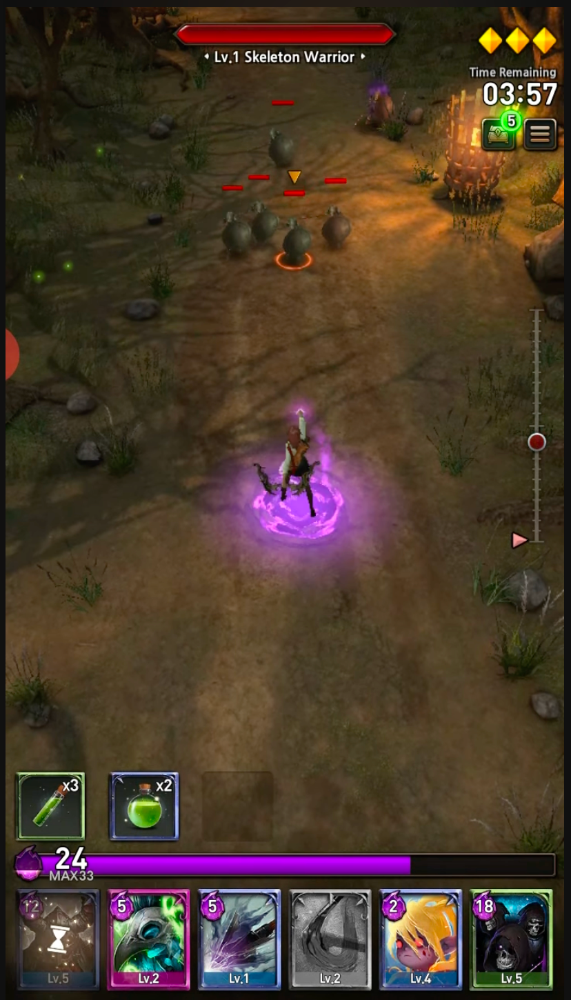
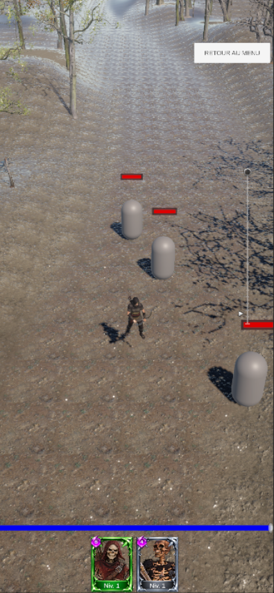
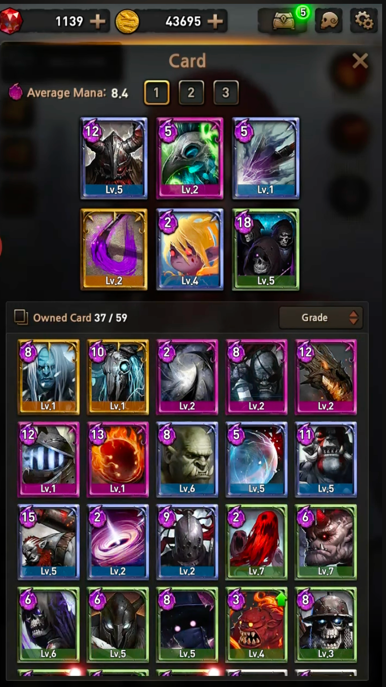
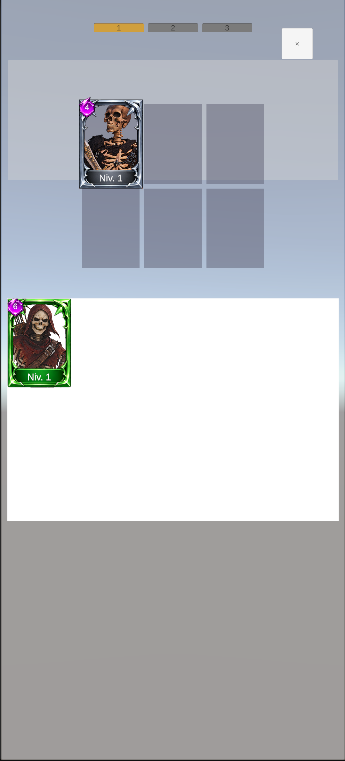
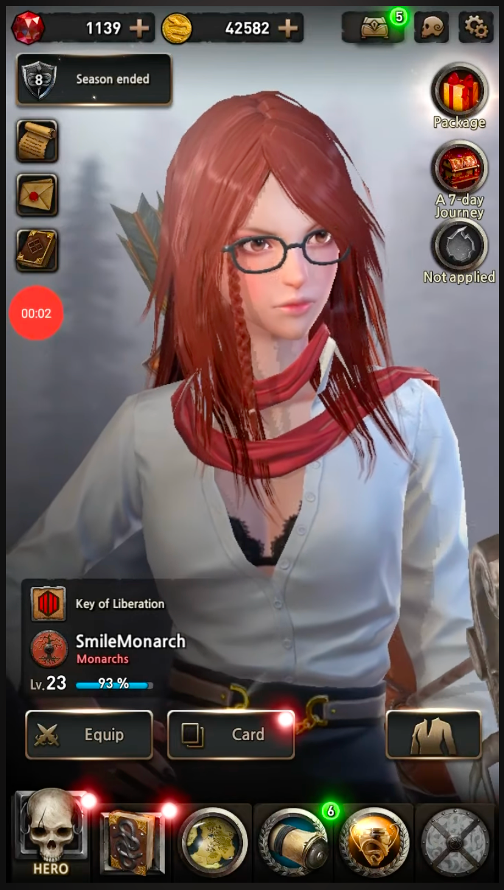
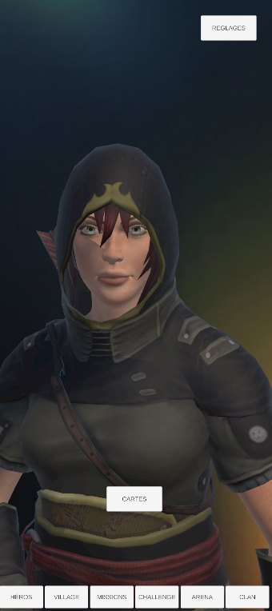

# First Summoner Reborn

An open-source Unity game project developed with the community.

## Before / After — Project Rebirth

A comparison between the original First Summoner and the current
work-in-progress version of First Summoner Reborn.

### Gameplay

| Before — Original | After — Reborn |
|:---:|:---:|
|  |  |

### Card Collection

| Before — Original | After — Reborn |
|:---:|:---:|
|  |  |

### Hero

| Before — Original | After — Reborn |
|:---:|:---:|
|  |  |

*Reborn screenshots show an early development build. Visuals and
interfaces are still evolving.*

## About

First Summoner Reborn is an original game project created with Unity.

The project is open to community contributions, with the goal of improving, expanding, and maintaining the game over time.

## Project Origins

**Original Creator & Project Initiator: LuisHRL, with assistance from artificial intelligence tools.**

First Summoner Reborn was originally conceived and developed by the creator credited above.

This repository preserves the project's origins while welcoming community development.

## Environment Assets and Building from Source

The `Assets/Environment/` directory is intentionally excluded from Git
and is not distributed with the source repository.

This directory contains environment resources such as meshes, prefabs,
materials, textures, and terrain data. Developers must provide their own
compatible resources to build and run the complete game from source.

The project aims to support configurable asset references and reusable
generation systems rather than depending on fixed asset identifiers.
However, compatibility with replacement assets is not guaranteed.

The absence of these assets from the repository does not mean they are
unnecessary for the game.

## Android Releases

Prebuilt Android APKs may be distributed through GitHub Releases.

These APKs are intended to include the resources required to play the
game, even though the corresponding environment source assets are not
included in the Git repository.

See the repository's Releases page for available builds.
## Contributing
Developers, artists, translators, and game designers are welcome to contribute.

Please read `CONTRIBUTING.md` before submitting changes.

## Credits

See `AUTHORS.md` for the original creator and community contributors.

## License

The original source code is licensed under the GNU General Public License v3.0.

Game assets and third-party dependencies may be subject to separate licenses.

Copyright © 2026 LuisHRL — original project code, to the extent owned by the original creator.